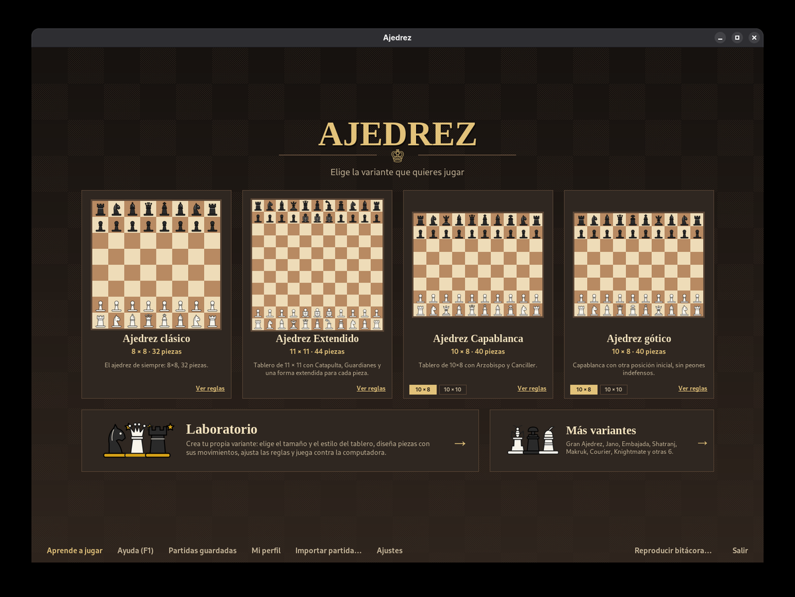
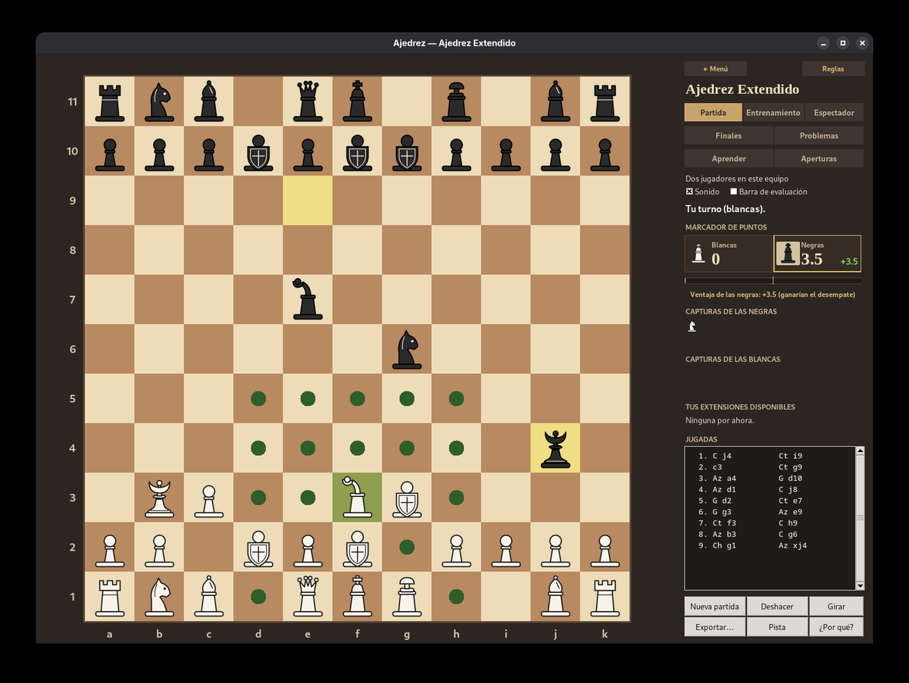
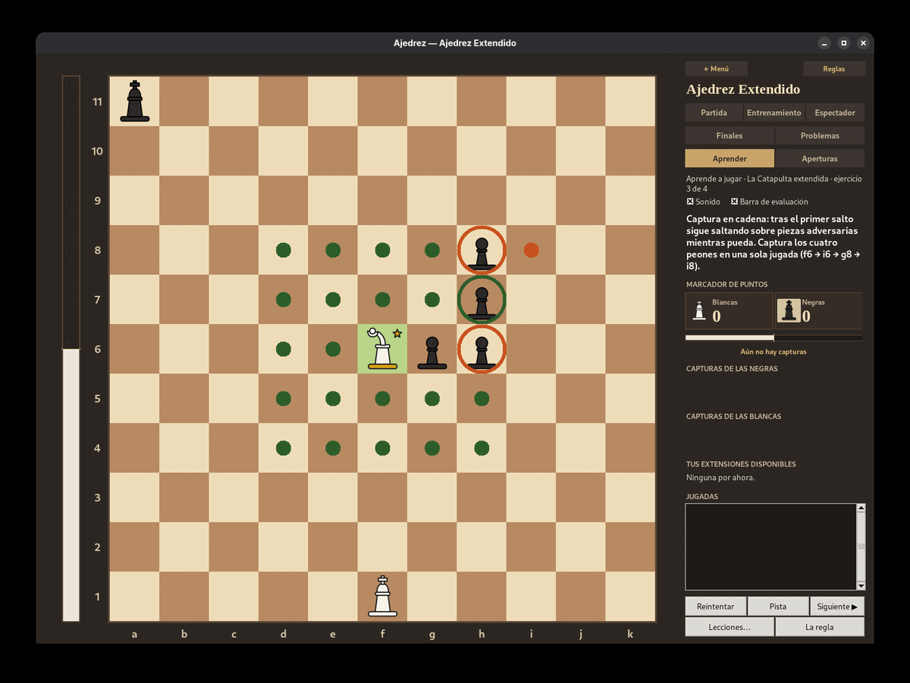
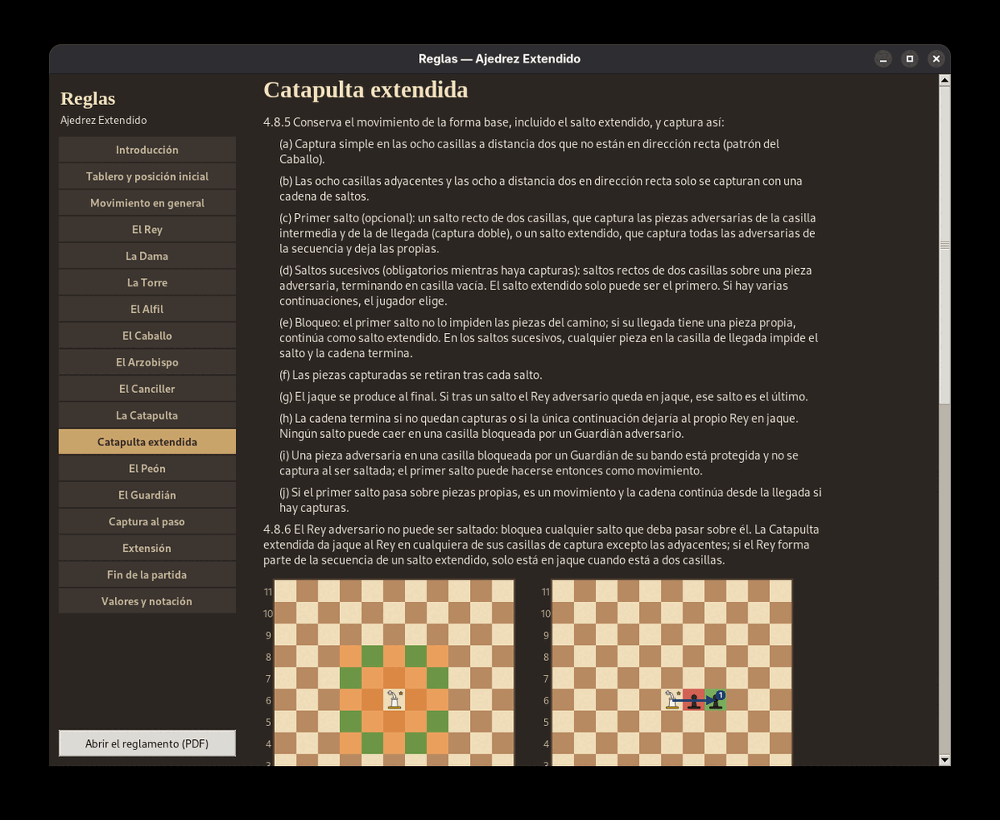
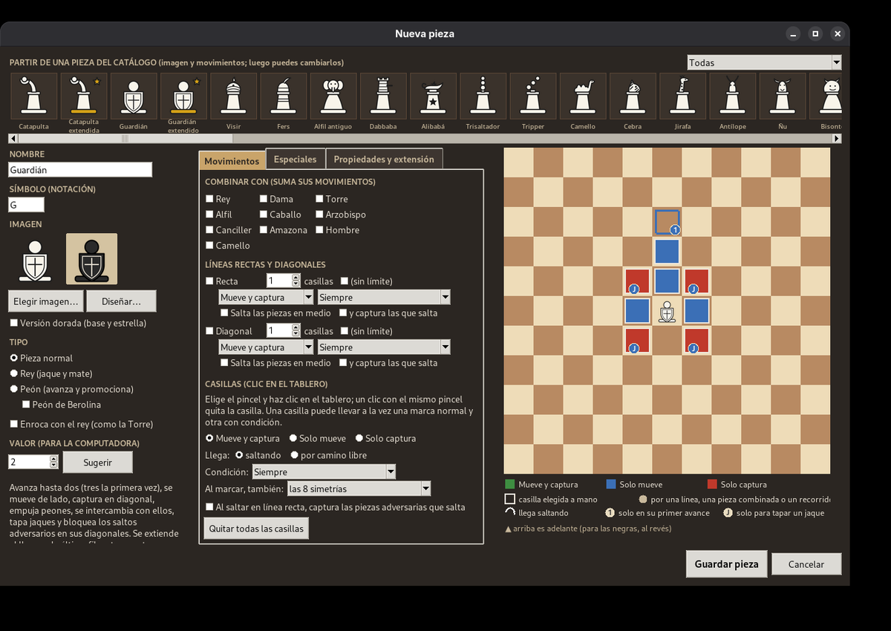

# Ajedrez Extendido

El **Ajedrez Extendido** es una variante de ajedrez en un tablero de 11 × 11, con piezas propias (la **Catapulta** y el **Guardián**), el
Arzobispo y el Canciller de Capablanca, un Caballo de salto largo y un sistema de **extensiones**: cada pieza,
salvo el Rey, tiene una forma extendida (mejorada). El proyecto incluye el reglamento, un juego de escritorio con computadora,
un motor y simulador para equilibrar las reglas, y las piezas para imprimir en 3D.



## Qué incluye

- **El juego** (`Juego/`): Ajedrez Extendido, clásico, Capablanca y gótico (también en 10 × 10) contra la
  computadora, con niveles calibrados en Elo (de 800 a ~3250), reloj, dos jugadores en el mismo equipo y modo
  espectador. Además, otras trece variantes: Gran Ajedrez, Jano, Embajada, Ajedrez moderno, Courier, Shatranj,
  Makruk, Los Álamos, Gardner, Berolina, Knightmate, Ajedrez de los saltamontes y Casi ajedrez.
- **Para aprender**: lecciones interactivas de cada pieza y regla especial, problemas de mate y tácticos (con su
  propio Elo y un problema del día), tus errores convertidos en problemas, práctica de finales con tablas
  exactas, explorador de aperturas y análisis de partidas.
- **Ayudas durante la partida**: pistas, «¿Por qué jugó eso?», avisos de piezas en peligro y revisión de la
  partida jugada a jugada.
- **El Laboratorio**: diseña tus propias variantes (tablero, piezas, reglas y posición inicial), partiendo de
  cualquier variante, incluido el Ajedrez Extendido completo. Las piezas se crean casilla por casilla en un
  tablero vacío (saltando o con el camino libre, con condiciones), con movimientos especiales (saltos sobre
  otras piezas, capturas en cadena, jinetes, piezas torcidas, empujes, intercambios, bloqueo de saltos) y su
  forma extendida con sus reglas; o se eligen de un catálogo de más de sesenta piezas mágicas de la literatura,
  cada una con su imagen. La computadora las juega y puede simularlas para medir su valor.
- **El simulador** (`Simulador/`): el motor del Ajedrez Extendido, SPRT para comparar versiones, afinado Texel, calibración
  de Elo, tablas de finales, extracción de problemas y libro de aperturas.
- **El reglamento oficial** en PDF (`Reglas/`) y las **piezas para impresión 3D** (`3D/`: STL y fuente en
  OpenSCAD).
- Interfaz en **español e inglés**, manual integrado (F1) y temas de tablero y de piezas.

| Partida contra la computadora | Lecciones |
|---|---|
|  |  |

| Reglas con diagramas | Editor de piezas del Laboratorio |
|---|---|
|  |  |

## Cómo jugar

Necesitas **Python 3.8 o más reciente con Tkinter**. Opcionalmente:

- **PyPy 3** (muy recomendable): la computadora piensa varias veces más rápido. El juego lo usa si encuentra
  `pypy3` en el PATH (o en `~/.local/bin/pypy3`).
- **Pillow**: piezas más nítidas al escalarlas.

```sh
cd Juego
./jugar.sh            # Linux y macOS (o: python3 ajedrez.py)
```

En Windows, `Juego\jugar.bat`. Para instalarlo con accesos directos, o para crear un paquete que incluya Python y
PyPy y no necesite instalar nada, consulta [`Instalador/LEEME.txt`](Instalador/LEEME.txt).

### Tablas de finales

Las tablas exactas de finales de Rey y **una** pieza contra Rey del Ajedrez Extendido y del ajedrez clásico vienen
incluidas: con ellas funciona la práctica de «Finales» y la computadora las usa en sus partidas. Las de las demás
variantes (Capablanca, gótico, Laboratorio) se construyen desde la ventana «Finales» con «Construir las que faltan»
(segundos o pocos minutos). Las de Rey y
**dos** piezas del Ajedrez Extendido (Torre + Torre, Alfil + Caballo...) ocupan 2.3 GB y no están en el repositorio; para
construirlas, desde `Simulador/` y con PyPy:

```sh
pasos/tablas_dos_piezas.sh             # ~45 min y ~9 GB de RAM
```

## Estructura

| Carpeta | Contenido |
|---|---|
| `Juego/` | El juego de escritorio (Tkinter). Documentación completa en [`Juego/LEEME.txt`](Juego/LEEME.txt). |
| `Simulador/` | Motor, búsqueda, simulaciones y herramientas de análisis. Ver [`Simulador/LEEME.txt`](Simulador/LEEME.txt). |
| `Reglas/` | Reglamento oficial en PDF (`actualizar_reglamento.py` aplica cambios de nombre y `reemplazar_pieza.py` cambia el dibujo de una pieza, sin rehacer el documento). |
| `Piezas/` | Imágenes de las piezas (SVG y PNG), estilos, prediseños y el generador de diseños. |
| `3D/` | Piezas para imprimir en 3D. Ver [`3D/LEEME.txt`](3D/LEEME.txt). |
| `Instalador/` | Instaladores para Windows, macOS y Linux, y empaquetadores. |
| `docs/` | Capturas de pantalla. |

## Lo que no está en el repositorio

Se generan en cada computadora y están en `.gitignore`:

- Resultados de simulaciones, calibraciones y bitácoras (`*.jsonl`): se recrean con los scripts de `Simulador/`.
  La escala de Elo ya calibrada sí está incluida (`Juego/niveles_elo.json`), igual que los problemas
  (`Juego/problemas.json`) y el libro de aperturas (`Juego/libro_aperturas.json`).
- Las tablas de finales de dos piezas del Ajedrez Extendido (2.3 GB).
- Los datos de cada jugador: perfil y Elo, ajustes, partidas guardadas, variantes y diseños del Laboratorio.

## Licencia

Copyright © 2026 Andres. El Ajedrez Extendido (juego, motor, reglamento, imágenes y modelos 3D) es software libre:
puedes redistribuirlo y modificarlo bajo los términos de la **Licencia Pública General de GNU, versión 3** (GPL v3),
publicada por la Free Software Foundation. Se distribuye con la esperanza de que sea útil, pero **sin ninguna
garantía**. El texto completo está en [`LICENSE`](LICENSE).

El estilo de piezas «Diagrama» sigue el juego de piezas de Colin M. L. Burnett (licencia BSD, compatible con la
GPL); su aviso está en [`Piezas/LEEME.txt`](Piezas/LEEME.txt).

---

## English

**Extended Chess** (*Ajedrez Extendido*) is a chess variant on an 11 × 11 board with two original pieces (the Catapult and the
Guardian), Capablanca's Archbishop and Chancellor, a long-jumping Knight and a system of extensions: every piece but
the King has an extended (improved) form. The repository contains the official rules (PDF, in Spanish), a
desktop game against the computer (Python + Tkinter; the interface can be switched to English in Settings),
a variant designer, an engine and simulator used to balance the rules, and 3D-printable pieces. Besides Extended
Chess, it plays classic, Capablanca and Gothic chess (also on 10 × 10) and thirteen more variants (Grand Chess,
Janus, Embassy, Shatranj, Makruk, Courier, Knightmate...). The variant designer can describe Extended Chess
itself, with over sixty fairy pieces from the literature (leapers, riders, hoppers, bent pieces...).

Run it with `cd Juego && ./jugar.sh` (Python 3 with Tkinter; PyPy 3 strongly recommended for a stronger
computer). Endgame tablebases for King and one piece are included; the two-piece ones (2.3 GB) are not:
build them with `Simulador/pasos/tablas_dos_piezas.sh`.

License: GNU General Public License v3 (see [`LICENSE`](LICENSE)). The «Diagram» piece style follows Colin M. L.
Burnett's BSD-licensed set (notice in `Piezas/LEEME.txt`).
